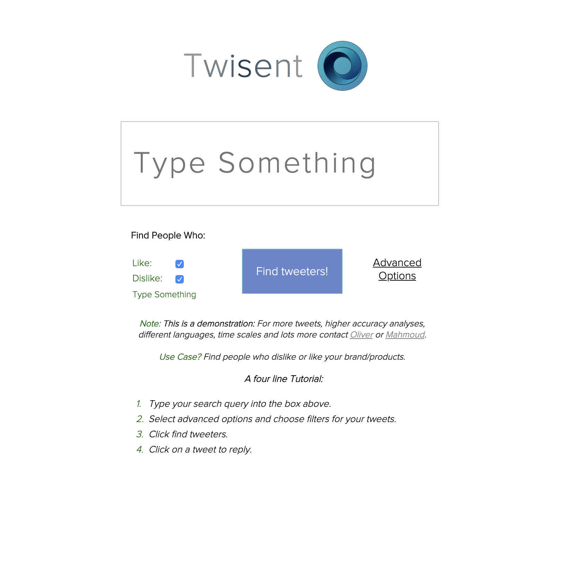
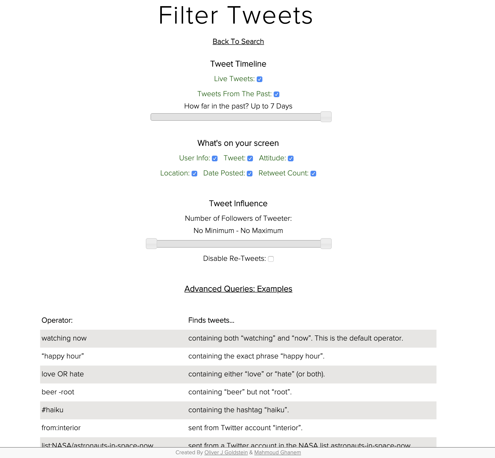

# twitter-sentiment-analysis
A failed startup to analyse twitter sentiments.

This is archived coursework, not a production service. Its dependencies and
protocols are old; run it only on a local development machine and do not expose
it directly to a network. The supplied start script binds to `127.0.0.1`.

To Compile run the RUN-ME.sh file with:
first chmod +x RUN-ME.sh

./RUN-ME.sh

Before starting the application, provide Twitter API credentials through the
environment. The application fails closed when any value is missing:

```sh
export TWITTER_CONSUMER_KEY="..."
export TWITTER_CONSUMER_SECRET="..."
export TWITTER_ACCESS_TOKEN="..."
export TWITTER_ACCESS_TOKEN_SECRET="..."
export TWISENT_DB_USER="twisent"
export TWISENT_DB_PASSWORD="..."
# Set to 0 only for local HTTP development. Production cookies require HTTPS.
export TWISENT_SECURE_COOKIES="1"
```

Use newly issued credentials and never commit real values or a populated
`.env` file. Give the database account access only to the `dashbrd` database;
do not run the application with a MySQL root account.



